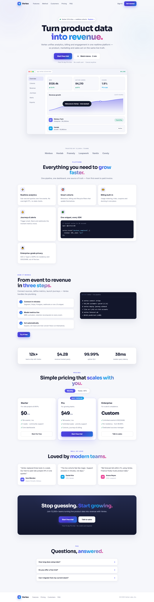

# Vertex — Turn Product Data Into Revenue

A beautiful, fully responsive light-theme landing page for **Vertex**, a fictional realtime customer-data platform. Plain **HTML + CSS + JS in separate files** — no frameworks, no build step.



## Preview

Open `index.html` directly in any modern browser, or serve the folder:

```bash
cd vertex
python -m http.server 8000
# visit http://localhost:8000
```

No dependencies required. Fonts load from Google Fonts (graceful offline fallback to system fonts).

## Structure

```
vertex/
  index.html      — markup (nav, hero, logos, features, how-it-works, stats, pricing, testimonials, CTA, FAQ, footer)
  styles.css      — all styling (CSS variables, layout, cards, dashboard mockup, responsive breakpoints)
  script.js       — behaviour (sticky nav, scroll progress, mobile menu, reveal-on-scroll, counters, pricing toggle, FAQ, toast)
  screenshot.png  — full-page preview shown above
  README.md       — this file
```

HTML, CSS and JS are deliberately kept in **separate files** — just open the page.

## What's inside

- Sticky glass navbar with scroll shadow, progress bar and mobile menu
- Hero with gradient headline, dual CTAs and a pure-CSS dashboard mockup (KPIs, chart, live feed)
- Logo strip + 6-tile features grid with code sample
- How-it-works split with terminal card + animated stats band
- Pricing with monthly/yearly toggle, testimonials, gradient CTA, FAQ accordion, footer
- Scroll-reveal animations, animated counters, toast notifications, smooth scrolling

## Theme

Clean light theme — soft off-white background, white elevated cards, indigo → sky-blue gradient accents, and a dark gradient CTA for contrast. Colours live in the `:root` variables at the top of `styles.css`.

## Customise

- Colours / fonts: edit the `:root` variables at the top of `styles.css`
- Copy: all section text lives in `index.html`
- Behaviour: menu + reveal + toggle + FAQ logic lives in `script.js`

